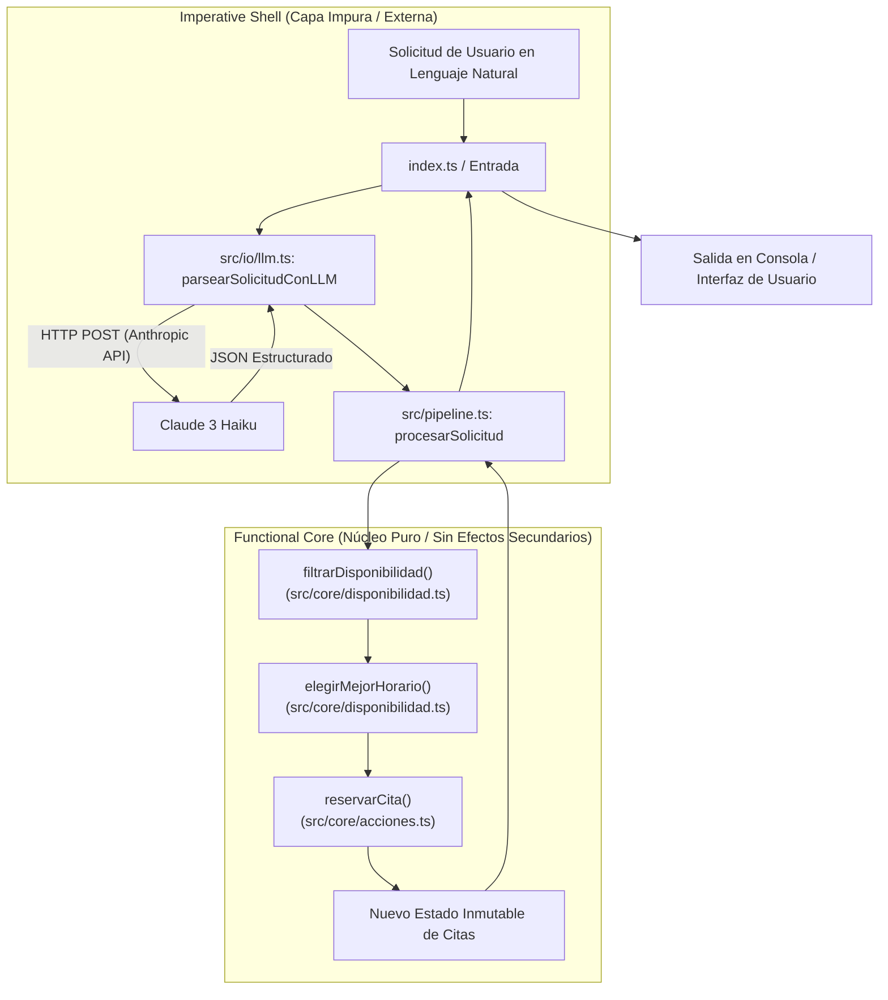

# 🌟 ORBIA — Agente Inteligente de Agendamiento de Citas

> **Proyecto Integrador de Programación Funcional aplicada a Agentes de Inteligencia Artificial**  
> Desarrollado con **TypeScript**, **Node.js** y la API de **Anthropic Claude**.

---

## 📌 1. Descripción General

**ORBIA** es un agente de software diseñado para gestionar el agendamiento automatizado de citas y reservas para negocios de servicios (como salones de belleza, spas, consultorios, etc.) a partir de solicitudes en lenguaje natural.

A diferencia de los asistentes conversacionales tradicionales basados en programación orientada a objetos mutable o scripts imperativos, **ORBIA** está concebido bajo el paradigma de **Programación Funcional (PF)** y la arquitectura de **Núcleo Funcional y Capa Imperativa (*Functional Core, Imperative Shell*)**.

### Objetivos Clave
- **Procesamiento de Lenguaje Natural**: Extracción precisa de intención, servicio, franja horaria y fecha mediante modelos de lenguaje (LLM).
- **Determinismo y Pureza Matemática**: Todo el cálculo de reglas de negocio, filtrado de disponibilidad y mutación de citas se ejecuta en un núcleo funcional libre de efectos secundarios.
- **Inmutabilidad Estricta**: Cada modificación en el estado genera un nuevo estado inmutable, garantizando trazabilidad total y eliminando condiciones de carrera o bugs de mutación de punteros en memoria.

---

## 🏛️ 2. Arquitectura: Functional Core, Imperative Shell

El sistema sigue una estricta separación de responsabilidades entre el mundo exterior (impuro, asíncrono, con efectos secundarios) y el dominio del negocio (puro, síncrono, predecible):



### Principio de Separación:
1. **Núcleo Funcional (`src/core/`)**:
   - **100% Funciones Puras**: Mismo input $\rightarrow$ Mismo output.
   - **Cero Efectos Secundarios**: Prohibido `console.log`, llamadas de red (`fetch`), mutaciones globales o lectura de variables de entorno.
   - **Inmutabilidad**: Prohibido `.push()`, `.splice()` o modificaciones directas. Se utilizan copias defensivas (`[...arr]`, `{...obj}`).
2. **Capa de I/O Impura (`src/io/`)**:
   - Confinamiento estricto de las llamadas de red y modelos de IA asíncronos en `src/io/llm.ts`.
3. **Orquestador Funcional (`src/pipeline.ts`)**:
   - Conecta la respuesta normalizada del LLM con las funciones puras del dominio para producir el resultado y la transición de estado.
4. **Capa Imperativa (`index.ts`)**:
   - Punto de entrada ejecutable. Configura dependencias, orquesta la ejecución y muestra los resultados.

---

## 🧬 3. Pilares de Programación Funcional Implementados

| Concepto Funcional | Dónde y Cómo se Aplica en ORBIA |
| :--- | :--- |
| **Inmutabilidad de Datos** | Todas las interfaces en [`src/types.ts`](file:///c:/Users/carmi/OneDrive/Desktop/ANTIGRAVTY%20PROGRAMAS/src/types.ts) usan modificadores `readonly` y `readonly T[]`. |
| **Funciones Puras** | Las funciones en [`src/core/`](file:///c:/Users/carmi/OneDrive/Desktop/ANTIGRAVTY%20PROGRAMAS/src/core/) (`filtrarDisponibilidad`, `elegirMejorHorario`, `reservarCita`, etc.) son deterministas y carecen de efectos colaterales. |
| **Copias Defensivas** | Para operaciones de ordenamiento como `.sort()` (que en JS muta in-situ), se hace copia previa: `[...opciones].sort(...)` en [`src/core/disponibilidad.ts`](file:///c:/Users/carmi/OneDrive/Desktop/ANTIGRAVTY%20PROGRAMAS/src/core/disponibilidad.ts). |
| **Funciones de Orden Superior (HOFs)** | Uso exhaustivo de métodos declarativos de arreglos: `.filter()`, `.map()`, `.find()`, `.some()`, eliminando bucles imperativos (`for`, `while`). |
| **Transición de Estado / Reducers** | Funciones que toman `(citasActuales, evento) => citasActualizadas` sin mutar la lista original (`[...citasActuales, nuevaCita]`). |
| **Tipos Algebraicos (ADTs)** | Modelado mediante Tipos de Unión Discriminada (`EstadoCita`, `FranjaHora`, `FranjaFecha`, `IntencionUsuario`, `Result<T, E>`). |

---

## 📂 4. Estructura del Proyecto

```text
ANTIGRAVTY PROGRAMAS/
├── .agents/                    # Configuraciones, reglas y habilidades del asistente AI
│   └── skills/bitacora-estudio/# Habilidad y registro de aprendizaje continuo
├── data/
│   └── negocios.mock.ts        # Catálogo mock de negocios, servicios y slots de horarios
├── src/
│   ├── core/                   # 🟢 NÚCLEO FUNCIONAL PURO (Zero Side-Effects)
│   │   ├── acciones.ts         # Transiciones de estado de citas (reservar, cancelar, modificar)
│   │   ├── disponibilidad.ts   # Algoritmos puros de filtrado y selección de mejores horarios
│   │   └── parse.ts            # Parser determinista basado en reglas (Fases 1 y 2)
│   ├── io/                     # 🔴 CAPA DE I/O IMPURA (Efectos Secundarios)
│   │   └── llm.ts              # Cliente Anthropic Claude para extracción estructurada JSON
│   ├── pipeline.ts             # 🔄 Pipeline de orquestación (solicitud -> LLM -> core -> resultado)
│   └── types.ts                # 📐 Definiciones de tipos inmutables y contratos del dominio
├── .env                        # Variables de entorno locales (API keys - no versionar)
├── .env.example                # Plantilla de variables de entorno requeridas
├── bitacora_de_estudio.md      # 📖 Bitácora incremental de estudio, prompts y cuestionario oral
├── index.ts                    # 🚀 Punto de entrada ejecutable (Imperative Shell)
├── package.json                # Metadatos del proyecto, dependencias y scripts
├── tsconfig.json               # Configuración del compilador TypeScript (modo estricto)
└── README.md                   # Esta documentación técnica
```

---

## 🔍 5. Especificación de Módulos

### 5.1 Tipos del Sistema ([`src/types.ts`](file:///c:/Users/carmi/OneDrive/Desktop/ANTIGRAVTY%20PROGRAMAS/src/types.ts))
Define el modelo formal de datos del sistema:
- **`SolicitudUsuario`**: Entrada en lenguaje natural con nombre, servicio y preferencias de fecha/hora.
- **`SolicitudEstructurada`**: Datos validados y normalizados con uniones literales (`"manana" | "tarde" | "noche"` y `"hoy" | "manana" | "esta_semana"`).
- **`Cita`**: Registro inmutable de cita con identificador único, timestamps y estado (`"confirmada" | "cancelada" | "modificada" | "pendiente"`).
- **`Result<T, E>`**: Tipo algebraico funcional para representar operaciones que pueden fallar de forma controlada (`ok: true` / `ok: false`).

### 5.2 Lógica de Disponibilidad ([`src/core/disponibilidad.ts`](file:///c:/Users/carmi/OneDrive/Desktop/ANTIGRAVTY%20PROGRAMAS/src/core/disponibilidad.ts))
- **`filtrarDisponibilidad(horarios, negocios, solicitud)`**: Evalúa slots libres, coincidencia de servicio y pertenencia a la franja horaria correspondiente.
- **`elegirMejorHorario(opciones)`**: Ordena de forma no destructiva (`[...opciones].sort`) y selecciona la opción óptima para el cliente.

### 5.3 Acciones y Transiciones de Estado ([`src/core/acciones.ts`](file:///c:/Users/carmi/OneDrive/Desktop/ANTIGRAVTY%20PROGRAMAS/src/core/acciones.ts))
- **`generarIdPuro(citasActuales)`**: Generación determinista de identificadores a partir de la longitud del estado actual.
- **`reservarCita(citasActuales, usuario, horario)`**: Retorna un nuevo arreglo inmutable que incluye la nueva reserva.
- **`cancelarCita(citasActuales, citaId)`**: Transición inmutable mapeando el registro objetivo a estado `"cancelada"`.
- **`consultarCitas(citasActuales, usuario)`**: Consulta declarativa filtrada por usuario.
- **`modificarCita(citasActuales, citaId, nuevosDatos)`**: Actualización inmutable de campos específicos.

### 5.4 Integración con LLM ([`src/io/llm.ts`](file:///c:/Users/carmi/OneDrive/Desktop/ANTIGRAVTY%20PROGRAMAS/src/io/llm.ts))
- Se comunica con la API de Anthropic (`claude-3-haiku-20240307`).
- Emplea un *system prompt* estricto que exige salida en formato JSON puro validado contra los tipos de `SolicitudEstructurada`.
- Manejo robusto de errores de red, JSON malformado y ausencia de variables de entorno.

### 5.5 Pipeline Orquestador ([`src/pipeline.ts`](file:///c:/Users/carmi/OneDrive/Desktop/ANTIGRAVTY%20PROGRAMAS/src/pipeline.ts))
Función `procesarSolicitud` que canaliza el flujo completo:
1. Parsea la solicitud mediante `parsearSolicitudConLLM`.
2. Filtra la disponibilidad en el catálogo mock.
3. Elige el mejor horario.
4. Si hay cupo, genera la nueva cita inmutable y responde con éxito; de lo contrario, notifica la indisponibilidad sin alterar el estado.

---

## 🚀 6. Instalación y Puesta en Marcha

### Requisitos Previos
- [Node.js](https://nodejs.org/) (versión 18.0.0 o superior recomendada).
- [npm](https://www.npmjs.com/) (incluido con Node.js).
- Una API Key válida de [Anthropic Console](https://console.anthropic.com/).

### Pasos de Instalación

1. **Clonar o abrir el directorio del proyecto**:
   ```bash
   cd "c:\Users\carmi\OneDrive\Desktop\ANTIGRAVTY PROGRAMAS"
   ```

2. **Instalar dependencias**:
   ```bash
   npm install
   ```

3. **Configurar variables de entorno**:
   Copia el archivo [.env.example](file:///c:/Users/carmi/OneDrive/Desktop/ANTIGRAVTY%20PROGRAMAS/.env.example) a un nuevo archivo `.env`:
   ```bash
   cp .env.example .env
   ```
   Abre `.env` y coloca tu API Key de Anthropic:
   ```env
   ANTHROPIC_API_KEY=sk-ant-api03-...
   ```

4. **Ejecutar el programa en modo desarrollo**:
   ```bash
   npm run dev
   ```

5. **Compilar el proyecto a JavaScript (opcional)**:
   ```bash
   npm run build
   ```
   Los archivos transpilados se generarán en la carpeta `dist/`.

---

## 💻 7. Ejemplo de Ejecución

Al ejecutar `npm run dev`, se procesa una solicitud de prueba configurada en [index.ts](file:///c:/Users/carmi/OneDrive/Desktop/ANTIGRAVTY%20PROGRAMAS/index.ts):

```typescript
const solicitudEjemplo: SolicitudUsuario = {
  nombreUsuario: "Cris",
  servicio: "corte de cabello",
  fechaPreferida: "viernes",
  horaPreferida: "tarde",
};
```

### Salida esperada en consola:
```text
Cita confirmada para Cris el 2026-09-11 a las 16:30.
Citas registradas: [
  {
    id: 'cita-1',
    usuario: 'Cris',
    negocioId: 'n1',
    servicioId: 's1',
    fecha: '2026-09-11',
    hora: '16:30',
    duracionMinutos: 30,
    estado: 'confirmada',
    creadaEn: '2026-09-22T14:15:00.000Z'
  }
]
```

---

## 📚 8. Material de Estudio y Preparación Académica

El proyecto incluye una bitácora técnica de estudio detallada en [`bitacora_de_estudio.md`](file:///c:/Users/carmi/OneDrive/Desktop/ANTIGRAVTY%20PROGRAMAS/bitacora_de_estudio.md), la cual contiene:
- El registro histórico paso a paso de cada fase de desarrollo.
- El cuestionario de defensa oral con preguntas típicas de examen de Programación Funcional.
- El glosario completo con explicaciones de conceptos como Transparencia Referencial, HOFs, ADTs e Inmutabilidad.

---

## 📄 Licencia y Créditos

Proyecto desarrollado con fines académicos y demostrativos para el estudio de **Programación Funcional y Arquitecturas de Software aplicadas a Inteligencia Artificial**.
